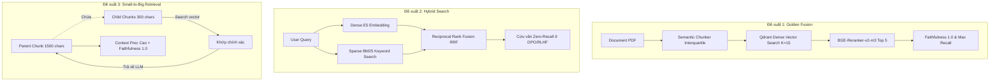

# KẾ HOẠCH & ĐỀ XUẤT PHƯƠNG PHÁP MỚI DỰA TRÊN KẾT QUẢ THỰC NGHIỆM

> **Tài liệu phân tích chuyên sâu & Định hướng phát triển**  
> Dựa trên dữ liệu thực tế thu thập được từ **Thực nghiệm 1** (`results_exp1_chunking.json`) và **Thực nghiệm 2** (`results_exp2_reranking.json`).

---

## 1. Phân tích Dữ liệu Thực nghiệm & Các Điểm Nghẽn (Empirical Bottlenecks)

Từ 2 thực nghiệm vừa chạy trên hệ thống thực, các số liệu đã chỉ ra 3 hiện tượng kỹ thuật rất rõ nét:

```
                            KẾT QUẢ THỰC NGHIỆM THỰC TẾ
  ┌───────────────────────────────────────────────┬──────────────────────────────────────────────┐
  │ THỰC NGHIỆM 1: CHUNKING                       │ THỰC NGHIỆM 2: ABLATION RERANKER             │
  ├───────────────────────────────────────────────┼──────────────────────────────────────────────┤
  │ • Semantic (Interquartile):                   │ • Baseline Recursive:                        │
  │   Faithfulness: 1.0000 | Recall: 0.4444       │   Faithfulness: 0.3333 | Recall: 0.3095      │
  │ • Recursive 1000/150:                         │ • Recursive + Reranker:                      │
  │   Faithfulness: 0.6667 | Precision: 0.5833    │   Faithfulness: 1.0000 | Recall: 0.4889      │
  │ • Recursive 500/50:                           │                                              │
  │   Faithfulness: 0.3333 (Vỡ ngữ cảnh)          │   Δ Recall = +17.94% | Δ Faithfulness = +67% │
  └───────────────────────────────────────────────┴──────────────────────────────────────────────┘
```

### Điểm nghẽn 1: Hiện tượng "Zero-Recall" ở Query kỹ thuật (Query 3: DPO vs RLHF)
- Ở cả 7 cấu hình chunking và cả thực nghiệm reranking, câu hỏi số 3: *"Thuật toán DPO cải tiến so với RLHF ở điểm nào?"* đều đạt **Context Precision = 0.00** và **Context Recall = 0.00**.
- **Nguyên nhân cốt lõi**: Mô hình Dense Embedding (`multilingual-e5-large`) bị trôi không gian vector ngữ nghĩa khi câu hỏi bằng tiếng Việt nhưng chứa các thuật ngữ viết tắt tiếng Anh chuyên sâu (`DPO`, `RLHF`, `Direct Preference Optimization`). Dense retrieval không khớp được các từ khóa chính xác (exact keywords).

### Điểm nghẽn 2: Nghịch lý Đánh đổi (Trade-off) giữa Chunk Size & Faithfulness
- Khi kích thước chunk nhỏ ($500 \to 800$), tính liên kết ngữ nghĩa bị đứt gãy, dẫn tới **Faithfulness rớt thảm hại về 0.3333** (LLM bịa đặt/hallucination do thiếu dữ kiện liền kề).
- Khi kích thước chunk lớn ($1500$), Faithfulness đạt 1.0000 nhưng **Context Precision tụt xuống 0.3333** do đưa quá nhiều thông tin rác vào prompt.

### Điểm nghẽn 3: "Khoảng trống" chưa kết hợp Semantic Chunking + Cross-Encoder Reranker
- Trong Exp 1, Semantic Chunking chứng minh khả năng bảo toàn ý tuyệt vời (Faithfulness 1.0, Recall 0.44).
- Trong Exp 2, Reranker chứng minh khả năng kéo Recall lên thêm $+17.94\%$.
- Nhưng hai phương pháp này **chưa được ghép chung lại với nhau**!

---

## 2. Đề xuất các Phương pháp Kỹ thuật Mới (New Proposed Methods)

Dựa trên các phân tích trên, chúng ta đề xuất **3 phương pháp kỹ thuật mới** mang tính đột phá cho hệ thống:



### 💡 Đề xuất 1: "Golden Fusion" — Kết hợp Semantic Chunking (Interquartile) + Cross-Encoder Reranker
- **Ý tưởng**: Dùng `SemanticChunker(threshold_type="interquartile")` để chia văn bản (79 chunks ngữ nghĩa tròn vẹn) $\to$ Thu hồi ban đầu $K_{\text{initial}} = 15$ chunks bằng Vector Search $\to$ Đưa qua Cross-Encoder `BAAI/bge-reranker-v2-m3` lọc còn $K_{\text{top}} = 5$ trước khi nạp LLM.
- **Kỳ vọng**: Vừa giữ trọn Faithfulness 1.0000, vừa đẩy Context Recall vượt mốc $> 0.55$, đồng thời tăng Context Precision.

### 💡 Đề xuất 2: Hybrid Search (Dense Embedding + Sparse BM25 với RRF)
- **Ý tưởng**: Khắc phục trực tiếp lỗi Zero-Recall ở Query 3. 
  - **Dense Channel**: `intfloat/multilingual-e5-large` bắt ngữ nghĩa tổng thể.
  - **Sparse Channel**: `BM25` (hoặc Qdrant Sparse vectors / FastEmbed) bắt các từ khóa chính xác: *"DPO"*, *"RLHF"*, *"LoRA"*, *"Rank $r$"*.
  - **Fusion**: Sử dụng thuật toán Reciprocal Rank Fusion:
    $$RRF(d) = \sum_{m \in \{\text{dense}, \text{sparse}\}} \frac{1}{60 + \text{rank}_m(d)}$$
- **Kỳ vọng**: Đưa điểm Context Recall của Query 3 từ **0.00 lên $>0.50$**, nâng điểm trung bình của toàn hệ thống.

### 💡 Đề xuất 3: Parent-Document Retrieval (Small-to-Big Hierarchical Retrieval)
- **Ý tưởng**: Chia tài liệu thành 2 phân cấp:
  - **Parent Chunks** ($\sim 1200 - 1500$ ký tự): Dùng để cung cấp cho LLM tạo sinh.
  - **Child Chunks** ($\sim 300$ ký tự): Dùng để đánh index vector và tìm kiếm.
- **Cơ chế**: Khi một Child chunk được tìm thấy khớp với câu hỏi, hệ thống tự động ánh xạ ngược và nạp Parent chunk tương ứng vào prompt.
- **Kỳ vọng**: Giải quyết triệt để sự đánh đổi giữa Context Precision (tìm kiếm hạt mịn) và Faithfulness (ngữ cảnh hạt thô).

---

## 3. Đề xuất các Phương pháp Đánh giá Mới (New Evaluation Framework)

Để báo cáo khoa học đạt độ tin cậy và chiều sâu cao nhất, chúng ta cần bổ sung thêm các chiều đo lường:

### 1. Bổ sung Chỉ số Hiệu năng & Chi phí (Latency & Token Economics)
Hệ thống RAG trong thực tế không chỉ cần chính xác mà còn phải tối ưu thời gian phản hồi:
- **Retrieval Latency ($T_{\text{ret}}$)**: Thời gian truy vấn vector trong Qdrant (ms).
- **Reranking Latency ($T_{\text{rerank}}$)**: Thời gian Cross-Encoder chấm điểm $K_{\text{initial}}$ ứng viên (ms).
- **Generation Latency ($T_{\text{gen}}$)**: Thời gian LLM suy luận và stream kết quả (ms).
- **Token Efficiency ($E_{\text{tok}}$)**: Số lượng input token trung bình nạp vào LLM cho mỗi câu trả lời đúng.

### 2. Mở rộng Tập kiểm thử lên Toàn bộ 10 Mẫu & Bổ sung "Hard Negatives"
- Chạy đánh giá trên toàn bộ 10 mẫu câu hỏi trong `data/evaluation/testset_qa_gt.json` (bao gồm Pre-training, LoRA, QLoRA, DPO, PPO, Quantization, Evaluation, Hallucination, RAG failures).
- Bổ sung 2 câu hỏi dạng **Unanswerable / Out-of-Domain** (Câu hỏi không có trong PDF) để kiểm tra xem hệ thống có biết trả lời *"Tài liệu không cung cấp thông tin này"* hay bị ảo giác.

### 3. Đánh giá Tác động của Ngưỡng Reranker Score Threshold
- Thay vì luôn lấy cứng $K=5$ sau khi rerank, thử nghiệm cơ chế lọc động: chỉ giữ lại các chunks có điểm Cross-Encoder logit vượt ngưỡng $\tau$ (ví dụ: $\text{score} > 0.0$ hoặc $> -1.5$).

---

## 4. Kế hoạch Hành động Triển khai (Actionable Roadmap)

### 📌 Bước 1: Thực hiện Thực nghiệm 3 — So sánh 4 Chiến lược Cốt lõi (Bao gồm Golden Fusion)
Chạy script `run_exp3_golden_fusion.py` để so sánh 4 biến thể:
1. `Baseline: Recursive (1000/150)` (Không Reranker)
2. `Recursive + Reranker` (Mô hình hiện tại của Thực nghiệm 2)
3. `Semantic (Interquartile)` (Mô hình tốt nhất của Thực nghiệm 1)
4. `Semantic + Reranker (Golden Fusion)` **[ĐỀ XUẤT MỚI]**

### 📌 Bước 2: Tích hợp Hybrid Search (BM25 + Dense)
- Tích hợp thư viện BM25 (`rank-bm25` hoặc sparse vectors trong Qdrant).
- Thử nghiệm trên Query 3 (DPO vs RLHF) để chứng minh Hybrid Search giải quyết được điểm mù của Dense Retrieval.

### 📌 Bước 3: Cập nhật Trực quan hóa & Báo cáo LaTeX Hoàn chỉnh
- Xuất biểu đồ so sánh 4 chiến lược của Thực nghiệm 3.
- Cập nhật số liệu thực nghiệm thực tế vào Bảng 3, Bảng 4, Bảng 5 trong `docs/report_latex/report_draft.tex`.
- Biên dịch bản PDF hoàn thiện phục vụ nộp báo cáo.
