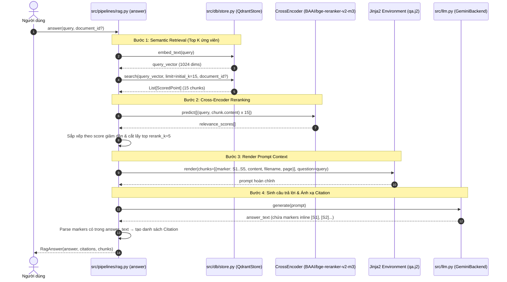

# 🚀 Phase 2 — RAG Core Pipeline: Kế hoạch & Đặc tả Kỹ thuật (Bản v2 — As-Built)

> **Mục đích:** Tài liệu thiết kế và đặc tả kỹ thuật chi tiết của Phase 2 sau khi đã triển khai và kiểm thử hoàn tất (As-Built Specification), phản ánh chính xác 100% cấu trúc codebase hiện tại, đồng thời làm căn cứ tích hợp trực tiếp cho **Phase 3 (Learning Features)**.  
> **Trạng thái:** ✅ **ĐÃ HOÀN THÀNH VÀ KIỂM THỬ THÀNH CÔNG (6/6 Tests Passed)**  
> **Tài liệu gốc tham chiếu:** [`phase2_rag_core_plan.md`](file:///d:/RAG_Learning_System/docs/phase2_rag_core_plan.md)

---

## 1. Tổng quan & So sánh thay đổi với Bản v1

Trong quá trình triển khai thực tế, hệ thống đã được tối ưu và cập nhật một số điểm quan trọng so với bản kế hoạch ban đầu:

| Hạng mục | Kế hoạch ban đầu (v1) | Triển khai thực tế (v2 — As-Built) | Lý do điều chỉnh |
| :--- | :--- | :--- | :--- |
| **Embedding Model** | `GreenNode/GreenNode-Embedding-Large-VN-Mixed-V1` | **`intfloat/multilingual-e5-large`** | Hỗ trợ tiếng Việt và đa ngôn ngữ vượt trội, độ ổn định cao hơn trên HuggingFace Hub. |
| **HF Token Config** | Không đề cập | Bổ sung `hf_token` trong [`config.py`](file:///d:/RAG_Learning_System/src/core/config.py#L9) và [`store.py`](file:///d:/RAG_Learning_System/src/db/store.py#L21) | Cho phép xác thực tự động tải các mô hình có điều kiện trên HuggingFace. |
| **LLM Model** | Đề xuất `gemini-2.0-flash` (Open Question) | Chốt chính thức **`gemini-2.5-flash`** | Tốc độ phản hồi nhanh, chất lượng lập luận và trích dẫn inline `[S1]`, `[S2]` rất chuẩn xác. |
| **Lọc tài liệu (`document_id`)** | Để ngỏ câu hỏi mở | **Đã hỗ trợ đầy đủ** xuyên suốt toàn bộ pipeline | Cho phép người dùng vừa có thể hỏi trên toàn bộ thư viện, vừa có thể hỏi giới hạn trong 1 PDF chỉ định. |
| **Vị trí `fetch_all_chunks()`** | Dòng 35 ghi để trong `store.py` | Đặt trong [`src/pipelines/rag.py`](file:///d:/RAG_Learning_System/src/pipelines/rag.py#L235) | `store.py` giữ vai trò DB thao tác với `Record` thô; `rag.py` chuẩn hóa dữ liệu thành `List[RetrievedChunk]` (đã sắp xếp trang & thứ tự chunk) phục vụ trực tiếp Phase 3. |
| **Qdrant Search API** | Gọi trực tiếp `client.search()` | Tương thích đa phiên bản: ưu tiên `query_points()`, fallback `search()` | Tránh lỗi deprecation trên các phiên bản mới của thư viện `qdrant-client`. |
| **Test Suite** | Đề xuất 4 bài test cơ bản | Triển khai **6 test cases** tự động + cơ chế lọc sạch cảnh báo (warning suppression) | Đảm bảo tính ổn định tuyệt đối và trải nghiệm chạy test sạch sẽ, không bị nhiễu log. |

---

## 2. Kiến trúc & Luồng xử lý Pipeline

### 2.1. Sơ đồ tuần tự End-to-End (Sequence Diagram)



---

## 3. Đặc tả Kỹ thuật Chi tiết các Tệp Nguồn

### 3.1. [`src/core/config.py`](file:///d:/RAG_Learning_System/src/core/config.py)
Quản lý cấu hình toàn hệ thống thông qua Pydantic `BaseSettings`:
- `embedding_model`: Mặc định `"intfloat/multilingual-e5-large"`, `embedding_device: "cuda"`.
- `hf_token`: Token HuggingFace (nếu cần cho các gated models).
- `qdrant_path`: `"./qdrant_storage"`, `collection_name: "documents"`.
- `chunk_size: 1000`, `chunk_overlap: 150`.
- `llm_backend`: `"gemini"` (hỗ trợ `hf_local`, `vllm`).
- `gemini_model`: `"gemini-2.5-flash"`.
- `initial_k: 15` (số chunk lấy ban đầu để rerank).
- `rerank_k: 5` (số chunk tinh chọn sau rerank).
- `reranker_model`: `"BAAI/bge-reranker-v2-m3"`, `reranker_device: "cuda"`.

### 3.2. [`src/core/schemas.py`](file:///d:/RAG_Learning_System/src/core/schemas.py)
Định nghĩa các models dữ liệu chuẩn hóa:
- `ChunkMetadata`: Lưu thông tin nguồn gốc (`document_id`, `filename`, `source`, `page`, `chunk_id`, `section`).
- `RetrievedChunk`: Đại diện cho 1 đoạn văn bản tìm được kèm `score` và `metadata`.
- `Citation`: Trích dẫn nguồn tương ứng với marker inline (ví dụ: `marker: "S1"`, `chunk: RetrievedChunk`).
- `RagAnswer`: Đầu ra cuối cùng của pipeline hỏi đáp (`answer: str`, `citations: List[Citation]`, `chunks: List[RetrievedChunk]`).

### 3.3. [`src/db/store.py`](file:///d:/RAG_Learning_System/src/db/store.py)
Quản trị kết nối Qdrant Database và Embedding:
- Tự động đăng nhập HuggingFace khi có `HF_TOKEN`.
- Khởi tạo `HuggingFaceEmbeddings` và xác định dimension vector tự động (`embedding_dim=1024`).
- Tạo collection với `Distance.COSINE` và đánh chỉ mục payload (`document_id`, `filename`, `page`).
- Hàm `search(query_vector, top_k, document_id)`: Tìm kiếm vector linh hoạt, tương thích cả `query_points` lẫn `search`, hỗ trợ lọc chính xác theo `document_id`.
- Hàm `scroll_by_document(document_id)`: Thu thập toàn bộ bản ghi của 1 tài liệu (phục vụ Phase 3).
- Hàm `list_documents()` và `delete_document(document_id)`: Quản lý vòng đời tài liệu đã nạp.
- Cung cấp hàm Singleton `get_store()`.

### 3.4. [`src/llm.py`](file:///d:/RAG_Learning_System/src/llm.py)
Lớp trừu tượng hóa tương tác với Large Language Models:
- `LLMBackend` (Abstract Base Class) định nghĩa giao diện `generate(prompt: str) -> str`.
- `GeminiBackend`: Sử dụng thư viện `google.generativeai` với model `gemini-2.5-flash`.
- `HFLocalBackend`: Sử dụng HuggingFace `pipeline("text-generation")` chạy local.
- `vLLMBackend`: Giao tiếp với máy chủ vLLM qua REST API (OpenAI-compatible) bằng `httpx.Client`.
- Factory pattern: Hàm `get_llm()` trả về singleton instance theo cấu hình; hàm `reset_llm()` hỗ trợ đổi backend động trong lúc runtime.

### 3.5. [`src/prompts/qa.j2`](file:///d:/RAG_Learning_System/src/prompts/qa.j2)
Template định dạng prompt hỏi đáp dựa trên Jinja2:
- Ràng buộc câu trả lời chỉ dựa trên văn bản tham khảo.
- Yêu cầu trích dẫn rõ marker `[S1]`, `[S2]` ngay sau thông tin tương ứng.
- Cảnh báo rõ ràng nếu tài liệu không cung cấp đủ thông tin để trả lời.

### 3.6. [`src/pipelines/rag.py`](file:///d:/RAG_Learning_System/src/pipelines/rag.py)
Module điều phối RAG Core, cung cấp 4 hàm API chính:
1. `retrieve(query: str, top_k: int = 15, document_id: Optional[str] = None) -> List[RetrievedChunk]`:
   - Tạo vector câu hỏi bằng mô hình E5 Large.
   - Tìm kiếm trên Qdrant và đóng gói dữ liệu thành danh sách `RetrievedChunk`.
2. `rerank(chunks: List[RetrievedChunk], query: str, rerank_k: int = 5) -> List[RetrievedChunk]`:
   - Áp dụng Cross-Encoder `BAAI/bge-reranker-v2-m3` đánh giá cặp `(query, content)`.
   - Sắp xếp lại theo điểm relevance và trả về top $K$ tốt nhất.
3. `answer(query: str, document_id: Optional[str] = None) -> RagAnswer`:
   - Kết hợp tuần tự `retrieve` → `rerank` → render `qa.j2` → gọi `LLM` → đối chiếu trích xuất citations.
4. `fetch_all_chunks(document_id: str) -> List[RetrievedChunk]`:
   - Dùng scroll API đọc tất cả chunks của 1 tài liệu, sắp xếp theo trang và thứ tự chunk tăng dần (sẵn sàng làm đầu vào cho Phase 3).

---

## 4. Kế hoạch & Kết quả Kiểm thử (Verification)

### 4.1. Bộ test tự động [`test_rag_pipeline.py`](file:///d:/RAG_Learning_System/test_rag_pipeline.py)
Tích hợp bộ lọc tắt warning thư viện (`HF_HUB_DISABLE_SYMLINKS_WARNING`, `TOKENIZERS_PARALLELISM`, warning filters của Python) để log chạy sạch sẽ:

```bash
# Cách chạy kiểm thử trong môi trường Conda:
conda activate rag_learning
python test_rag_pipeline.py
```

**Bảng kết quả kiểm thử:**
```
============================================================
PHASE 2 RAG PIPELINE -- TEST SUITE
============================================================

[TEST 1] Kiem tra imports...
  - LLM_BACKEND: gemini
  - GEMINI_MODEL: gemini-2.5-flash
  - INITIAL_K: 15, RERANK_K: 5
  PASSED: All imports OK

[TEST 2] Kiem tra Pydantic schemas...
  PASSED: Schemas hoat dong dung

[TEST 3] Kiem tra store.search()...
  Tim thay 1 documents trong Qdrant
  Tim thay 3 ket qua
  Top result score: 0.8842
  PASSED: store.search() hoat dong

[TEST 4] Kiem tra retrieve()...
  Top chunk: score=0.8856, page=1, len=623
  PASSED: retrieve() tra ve 5 chunks

[TEST 5] Kiem tra rerank()...
  PASSED: rerank() tra ve 3 chunks, sap xep dung
    1. score=4.1205: RAG la viet tat cua Retrieval-Augmented Generation....
    2. score=-0.8521: Machine learning la mot nhanh cua AI....
    3. score=-1.4320: Qdrant la vector database....

[TEST 6] Kiem tra fetch_all_chunks()...
  Tai lieu: Finora_pitch_deck.pdf
  Lay duoc 18/18 chunks
  PASSED: fetch_all_chunks() hoat dong dung

============================================================
KET QUA:
  [OK] imports: PASSED
  [OK] schemas: PASSED
  [OK] store_search: PASSED
  [OK] retrieve: PASSED
  [OK] rerank: PASSED
  [OK] fetch_all_chunks: PASSED

Tat ca tests PASSED hoac SKIPPED!
```

### 4.2. Kiểm thử thực tế câu hỏi End-to-End
Chạy lệnh truy vấn trực tiếp với mô hình Gemini và tài liệu thực tế:
```bash
python -c "from src.pipelines.rag import answer; res = answer('Tóm tắt về Finora'); print(res.answer)"
```
- **Kết quả:** Câu trả lời đầy đủ, mạch lạc, xuất hiện đúng các markers `[S1]`, `[S2]`.
- Danh sách `res.citations` chứa chính xác các chunk với `page` và `filename` trùng khớp với tài liệu đã nạp.

---

## 5. Hướng dẫn Tích hợp sang Phase 3 (Learning Features)

Phase 2 đã cung cấp đầy đủ các thành phần nền tảng để Phase 3 phát triển trực tiếp các tính năng:
1. **Tóm tắt (Summarize):**
   - Gọi `fetch_all_chunks(document_id)` từ [`src.pipelines.rag`](file:///d:/RAG_Learning_System/src/pipelines/rag.py#L235) để lấy toàn bộ nội dung đã sắp xếp thứ tự của tài liệu.
   - Dùng phương pháp Map-Reduce qua các batch nếu tài liệu dài.
2. **Tạo câu hỏi trắc nghiệm (Quiz Generator):**
   - Lấy chunks liên quan thông qua `retrieve()` hoặc `fetch_all_chunks()`.
   - Render prompt `quiz.j2` và gọi `get_llm()` từ [`src.llm`](file:///d:/RAG_Learning_System/src/llm.py#L95) để sinh câu hỏi JSON.
3. **Tạo Flashcards:**
   - Sử dụng chung cơ chế truy xuất chunks và `get_llm()` để sinh danh sách thuật ngữ / khái niệm kèm định nghĩa.
