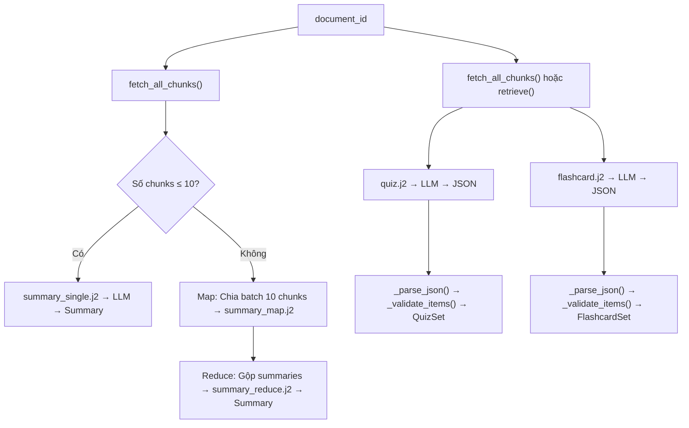

# Phase 3 — Learning Features: Kế hoạch triển khai chi tiết

> **Mục tiêu:** Tạo 3 tính năng học tập từ tài liệu đã nạp: **Tóm tắt (Summarize)**, **Tạo Quiz (MCQ)**, và **Tạo Flashcards**.

---

## 📊 Tổng quan kiến trúc



---

## 📁 Danh sách files cần tạo/sửa

| # | File | Hành động | Mô tả |
|---|------|-----------|-------|
| 1 | [`src/core/schemas.py`](file:///d:/RAG_Learning_System/src/core/schemas.py) | **Sửa** | Thêm 5 schema mới: `Summary`, `QuizItem`, `QuizSet`, `Flashcard`, `FlashcardSet` |
| 2 | [`src/core/config.py`](file:///d:/RAG_Learning_System/src/core/config.py) | **Sửa** | Thêm 3 cấu hình: `summarize_batch_size`, `n_quiz_questions`, `n_flashcards` |
| 3 | [`.env`](file:///d:/RAG_Learning_System/.env) | **Sửa** | Thêm 3 biến môi trường tương ứng |
| 4 | `src/prompts/summary_single.j2` | **Tạo mới** | Prompt tóm tắt tài liệu ngắn (≤ 10 chunks) |
| 5 | `src/prompts/summary_map.j2` | **Tạo mới** | Prompt tóm tắt từng batch (giai đoạn Map) |
| 6 | `src/prompts/summary_reduce.j2` | **Tạo mới** | Prompt gộp các tóm tắt con thành tóm tắt tổng (giai đoạn Reduce) |
| 7 | `src/prompts/quiz.j2` | **Tạo mới** | Prompt tạo câu hỏi trắc nghiệm MCQ dạng JSON |
| 8 | `src/prompts/flashcard.j2` | **Tạo mới** | Prompt tạo flashcards dạng JSON |
| 9 | `src/pipelines/learning.py` | **Tạo mới** | Module chính: `summarize()`, `generate_quiz()`, `generate_flashcards()` + helpers |
| 10 | `test_learning_features.py` | **Tạo mới** | Test suite cho toàn bộ Phase 3 |

---

## 🔧 Chi tiết triển khai từng bước

### Bước 1: Thêm Pydantic Schemas vào [`schemas.py`](file:///d:/RAG_Learning_System/src/core/schemas.py)

Thêm section mới phía dưới `RagAnswer`:

```python
# ============================================================
# 3. LEARNING FEATURE SCHEMAS
# ============================================================

class Summary(BaseModel):
    """Bản tóm tắt tài liệu."""
    content: str                        # Nội dung tóm tắt
    document_id: str                    # ID tài liệu được tóm tắt
    total_chunks: int                   # Tổng số chunks đã xử lý
    method: str                         # "single" hoặc "map_reduce"


class QuizItem(BaseModel):
    """Một câu hỏi trắc nghiệm (MCQ)."""
    question: str
    options: List[str]                  # Danh sách 4 đáp án [A, B, C, D]
    answer: str                         # Đáp án đúng: "A" | "B" | "C" | "D"
    explanation: str                    # Giải thích vì sao đáp án đúng


class QuizSet(BaseModel):
    """Bộ câu hỏi trắc nghiệm từ tài liệu."""
    items: List[QuizItem]
    document_id: str
    topic: Optional[str] = None         # Chủ đề cụ thể (nếu có)


class Flashcard(BaseModel):
    """Một thẻ ghi nhớ (flashcard)."""
    front: str                          # Mặt trước: câu hỏi / khái niệm
    back: str                           # Mặt sau: đáp án / giải thích


class FlashcardSet(BaseModel):
    """Bộ flashcards từ tài liệu."""
    cards: List[Flashcard]
    document_id: str
    topic: Optional[str] = None
```

> [!NOTE]
> So với `project_plan.md` gốc, tôi đã **bỏ `citations` khỏi `QuizSet` và `FlashcardSet`** vì quiz/flashcard được sinh từ toàn bộ nội dung tài liệu (không cần gắn marker inline như Q&A). Thay vào đó, thêm `document_id` và `topic` để truy vết nguồn gốc.

---

### Bước 2: Thêm cấu hình vào [`config.py`](file:///d:/RAG_Learning_System/src/core/config.py) và [`.env`](file:///d:/RAG_Learning_System/.env)

**config.py** — thêm 3 fields sau block `reranker_device`:
```python
    # Learning Features
    summarize_batch_size: int = Field(default=10)   # chunks mỗi batch khi Map-Reduce
    n_quiz_questions: int = Field(default=8)         # số câu hỏi quiz
    n_flashcards: int = Field(default=15)            # số flashcards
```

**.env** — thêm section mới:
```dotenv
# Learning Features
SUMMARIZE_BATCH_SIZE=10
N_QUIZ_QUESTIONS=8
N_FLASHCARDS=15
```

---

### Bước 3: Tạo 5 Jinja2 templates trong `src/prompts/`

#### 3.1 `summary_single.j2` — Tóm tắt tài liệu ngắn (≤ batch_size chunks)

```jinja2
Ban la tro ly hoc tap chuyen nghiep. Nhiem vu cua ban la tom tat noi dung tai lieu duoi day mot cach ro rang, suc tich va co cau truc.

**Quy tac:**
1. Tom tat cac y chinh va thong tin quan trong nhat.
2. Su dung dau gach dau dong hoac so thu tu de liet ke cac diem chinh.
3. Giu nguyen ngon ngu cua tai lieu (Tieng Viet hoac Tieng Anh).
4. Khong them thong tin khong co trong tai lieu.
5. Do dai tom tat: 300-600 tu.

**Noi dung tai lieu:**

---
[Trang {{ chunk.page }}]
{{ chunk.content }}

---

**Ban tom tat:**
```

#### 3.2 `summary_map.j2` — Tóm tắt từng batch (Map phase)

```jinja2
Ban la tro ly hoc tap chuyen nghiep. Hay tom tat ngan gon phan noi dung tai lieu duoi day.

**Quy tac:**
1. Chi tom tat cac y chinh va thong tin cot loi.
2. Giu cau truc ro rang, dung dau gach dau dong.
3. Do dai: 150-300 tu.
4. Khong them thong tin ngoai tai lieu.

**Phan noi dung (batch {{ batch_index }}/{{ total_batches }}):**

---
[Trang {{ chunk.page }}]
{{ chunk.content }}

---

**Tom tat phan nay:**
```

#### 3.3 `summary_reduce.j2` — Gộp summaries thành tóm tắt tổng (Reduce phase)

```jinja2
Ban la tro ly hoc tap chuyen nghiep. Duoi day la cac ban tom tat rieng le cua tung phan trong mot tai lieu. Hay gop chung lai thanh MOT ban tom tat tong the, mach lac va day du.

**Quy tac:**
1. Ket hop tat ca cac ban tom tat thanh mot bai viet lien mach.
2. Loai bo thong tin trung lap giua cac phan.
3. Sap xep lai theo thu tu logic (khong nhat thiet theo thu tu ban dau).
4. Su dung cac tieu de phu (heading) neu can thiet de cau truc bai tom tat.
5. Do dai: 400-800 tu.

**Cac ban tom tat thanh phan:**

--- Phan {{ loop.index }}/{{ summaries|length }} ---
{{ summary }}

---

**Ban tom tat tong the:**
```

#### 3.4 `quiz.j2` — Tạo câu hỏi trắc nghiệm MCQ

```jinja2
Ban la giao vien chuyen tao de kiem tra. Hay tao {{ n_questions }} cau hoi trac nghiem (MCQ) tu noi dung tai lieu duoi day.

**Chu de tap trung:** {{ topic }}


**Quy tac:**
1. Moi cau hoi co dung 4 lua chon: A, B, C, D.
2. Chi co dung 1 dap an dung cho moi cau.
3. Cau hoi phai da dang: co ca cau kien thuc, cau hieu biet, va cau ung dung.
4. Giai thich ngan gon vi sao dap an do la dung.
5. Khong tao cau hoi trung lap hoac qua giong nhau.
6. Tra loi bang DUNG dinh dang JSON duoi day, KHONG them bat ky van ban nao khac.

**Noi dung tai lieu:**

---
{{ chunk.content }}

---

**Tra ve JSON theo dinh dang SAU (KHONG them text ngoai JSON):**
```json
[
  {
    "question": "Cau hoi o day?",
    "options": ["A. Lua chon 1", "B. Lua chon 2", "C. Lua chon 3", "D. Lua chon 4"],
    "answer": "A",
    "explanation": "Giai thich vi sao A dung."
  }
]
```
```

#### 3.5 `flashcard.j2` — Tạo flashcards

```jinja2
Ban la giao vien chuyen tao the ghi nho (flashcard) de giup hoc sinh on tap hieu qua. Hay tao {{ n_cards }} flashcards tu noi dung tai lieu duoi day.

**Chu de tap trung:** {{ topic }}


**Quy tac:**
1. Mat truoc (front): Cau hoi ngan gon hoac khai niem can nho.
2. Mat sau (back): Dap an hoac giai thich suc tich (1-3 cau).
3. Cac the phai da dang: bao gom dinh nghia, su kien, so sanh, ung dung.
4. Khong tao the trung lap.
5. Tra loi bang DUNG dinh dang JSON duoi day, KHONG them bat ky van ban nao khac.

**Noi dung tai lieu:**

---
{{ chunk.content }}

---

**Tra ve JSON theo dinh dang SAU (KHONG them text ngoai JSON):**
```json
[
  {
    "front": "Khai niem / Cau hoi o day?",
    "back": "Dap an / Giai thich o day."
  }
]
```
```

---

### Bước 4: Tạo `src/pipelines/learning.py` — Module chính

```python
"""
Learning Features Pipeline -- Phase 3

Cac ham chinh:
  summarize()           - Tom tat tai lieu (single hoac map-reduce)
  generate_quiz()       - Tao bo cau hoi trac nghiem MCQ
  generate_flashcards() - Tao bo flashcards
"""

import json
import re
from typing import List, Optional, Any

from src.core.config import settings
from src.core.schemas import (
    RetrievedChunk, Summary, QuizItem, QuizSet, Flashcard, FlashcardSet
)
from src.pipelines.rag import fetch_all_chunks, _get_jinja_env
from src.llm import get_llm


# ============================================================
# PRIVATE HELPERS
# ============================================================

def _parse_json(raw_text: str) -> Any:
    """
    Parse JSON tu LLM response, tu dong strip markdown fences.
    
    LLM thuong tra ve:
      ```json\n[...]\n```
    Ham nay se lam sach va parse thanh Python object.
    """
    text = raw_text.strip()
    
    # Loai bo markdown code fences: ```json ... ``` hoac ``` ... ```
    text = re.sub(r'^```(?:json)?\s*\n?', '', text)
    text = re.sub(r'\n?```\s*$', '', text)
    text = text.strip()
    
    return json.loads(text)


def _validate_quiz_items(raw_items: list) -> List[QuizItem]:
    """
    Loc va validate danh sach quiz items tu LLM output.
    - Loai bo items thieu field bat buoc
    - Loai bo items bi trung cau hoi
    - Dam bao answer la A/B/C/D
    """
    valid = []
    seen_questions = set()
    
    for item in raw_items:
        # Kiem tra cac field bat buoc
        if not all(k in item for k in ("question", "options", "answer", "explanation")):
            continue
        
        # Kiem tra options co dung 4 lua chon
        if not isinstance(item["options"], list) or len(item["options"]) != 4:
            continue
        
        # Kiem tra answer hop le
        if item["answer"].strip().upper() not in ("A", "B", "C", "D"):
            continue
        
        # Kiem tra trung lap
        q_normalized = item["question"].strip().lower()
        if q_normalized in seen_questions:
            continue
        seen_questions.add(q_normalized)
        
        valid.append(QuizItem(
            question=item["question"].strip(),
            options=item["options"],
            answer=item["answer"].strip().upper(),
            explanation=item["explanation"].strip(),
        ))
    
    return valid


def _validate_flashcard_items(raw_items: list) -> List[Flashcard]:
    """
    Loc va validate danh sach flashcard items tu LLM output.
    - Loai bo items thieu front/back
    - Loai bo items bi trung front
    """
    valid = []
    seen_fronts = set()
    
    for item in raw_items:
        if not all(k in item for k in ("front", "back")):
            continue
        
        if not item["front"].strip() or not item["back"].strip():
            continue
        
        front_normalized = item["front"].strip().lower()
        if front_normalized in seen_fronts:
            continue
        seen_fronts.add(front_normalized)
        
        valid.append(Flashcard(
            front=item["front"].strip(),
            back=item["back"].strip(),
        ))
    
    return valid


def _chunks_to_context(chunks: List[RetrievedChunk]) -> List[dict]:
    """Chuyen doi chunks thanh context dicts cho Jinja2."""
    return [
        {"content": c.content, "page": c.metadata.page}
        for c in chunks
    ]


# ============================================================
# PUBLIC API
# ============================================================

def summarize(document_id: str) -> Summary:
    """
    Tom tat tai lieu. Tu dong chon strategy:
    - Neu <= batch_size chunks: dung summary_single.j2
    - Neu > batch_size chunks: dung Map-Reduce (summary_map.j2 + summary_reduce.j2)
    """
    chunks = fetch_all_chunks(document_id)
    if not chunks:
        return Summary(
            content="Khong tim thay noi dung tai lieu.",
            document_id=document_id,
            total_chunks=0,
            method="single",
        )
    
    batch_size = settings.summarize_batch_size
    env = _get_jinja_env()
    llm = get_llm()
    
    if len(chunks) <= batch_size:
        # === SINGLE SUMMARY ===
        template = env.get_template("summary_single.j2")
        context = _chunks_to_context(chunks)
        prompt = template.render(chunks=context)
        summary_text = llm.generate(prompt)
        
        return Summary(
            content=summary_text.strip(),
            document_id=document_id,
            total_chunks=len(chunks),
            method="single",
        )
    else:
        # === MAP-REDUCE ===
        # MAP: Chia batch va tom tat tung batch
        batches = [chunks[i:i+batch_size] for i in range(0, len(chunks), batch_size)]
        map_template = env.get_template("summary_map.j2")
        
        partial_summaries = []
        for idx, batch in enumerate(batches):
            context = _chunks_to_context(batch)
            prompt = map_template.render(
                chunks=context,
                batch_index=idx + 1,
                total_batches=len(batches),
            )
            partial = llm.generate(prompt)
            partial_summaries.append(partial.strip())
            print(f"  Map batch {idx+1}/{len(batches)} hoan thanh.")
        
        # REDUCE: Gop cac tom tat con thanh tom tat tong
        reduce_template = env.get_template("summary_reduce.j2")
        reduce_prompt = reduce_template.render(summaries=partial_summaries)
        final_summary = llm.generate(reduce_prompt)
        
        return Summary(
            content=final_summary.strip(),
            document_id=document_id,
            total_chunks=len(chunks),
            method="map_reduce",
        )


def generate_quiz(
    document_id: str,
    topic: Optional[str] = None,
    n_questions: Optional[int] = None,
) -> QuizSet:
    """
    Tao bo cau hoi trac nghiem MCQ tu tai lieu.
    
    Args:
        document_id: ID tai lieu
        topic: Chu de cu the (None = toan bo tai lieu)
        n_questions: So cau hoi (mac dinh: settings.n_quiz_questions)
    """
    if n_questions is None:
        n_questions = settings.n_quiz_questions
    
    # Lay chunks: neu co topic thi retrieve theo topic, khong thi lay tat ca
    if topic:
        from src.pipelines.rag import retrieve
        chunks = retrieve(topic, top_k=settings.initial_k, document_id=document_id)
    else:
        chunks = fetch_all_chunks(document_id)
    
    if not chunks:
        return QuizSet(items=[], document_id=document_id, topic=topic)
    
    # Render prompt
    env = _get_jinja_env()
    template = env.get_template("quiz.j2")
    context = _chunks_to_context(chunks)
    prompt = template.render(chunks=context, n_questions=n_questions, topic=topic)
    
    # Goi LLM
    llm = get_llm()
    raw_response = llm.generate(prompt)
    
    # Parse JSON + validate
    try:
        raw_items = _parse_json(raw_response)
    except json.JSONDecodeError as e:
        print(f"Warning: LLM tra ve JSON khong hop le: {e}")
        return QuizSet(items=[], document_id=document_id, topic=topic)
    
    valid_items = _validate_quiz_items(raw_items)
    
    return QuizSet(
        items=valid_items[:n_questions],
        document_id=document_id,
        topic=topic,
    )


def generate_flashcards(
    document_id: str,
    topic: Optional[str] = None,
    n_cards: Optional[int] = None,
) -> FlashcardSet:
    """
    Tao bo flashcards tu tai lieu.
    
    Args:
        document_id: ID tai lieu
        topic: Chu de cu the (None = toan bo tai lieu)
        n_cards: So flashcards (mac dinh: settings.n_flashcards)
    """
    if n_cards is None:
        n_cards = settings.n_flashcards
    
    # Lay chunks
    if topic:
        from src.pipelines.rag import retrieve
        chunks = retrieve(topic, top_k=settings.initial_k, document_id=document_id)
    else:
        chunks = fetch_all_chunks(document_id)
    
    if not chunks:
        return FlashcardSet(cards=[], document_id=document_id, topic=topic)
    
    # Render prompt
    env = _get_jinja_env()
    template = env.get_template("flashcard.j2")
    context = _chunks_to_context(chunks)
    prompt = template.render(chunks=context, n_cards=n_cards, topic=topic)
    
    # Goi LLM
    llm = get_llm()
    raw_response = llm.generate(prompt)
    
    # Parse JSON + validate
    try:
        raw_items = _parse_json(raw_response)
    except json.JSONDecodeError as e:
        print(f"Warning: LLM tra ve JSON khong hop le: {e}")
        return FlashcardSet(cards=[], document_id=document_id, topic=topic)
    
    valid_cards = _validate_flashcard_items(raw_items)
    
    return FlashcardSet(
        cards=valid_cards[:n_cards],
        document_id=document_id,
        topic=topic,
    )
```

---

### Bước 5: Tạo `test_learning_features.py` — Test suite

| # | Tên test | Kiểm tra gì |
|---|----------|-------------|
| 1 | `test_imports` | Import được tất cả schemas mới + hàm trong `learning.py` |
| 2 | `test_schemas` | Tạo instance `Summary`, `QuizItem`, `QuizSet`, `Flashcard`, `FlashcardSet` thành công |
| 3 | `test_parse_json` | `_parse_json()` xử lý đúng: JSON thuần, JSON có markdown fences, JSON có khoảng trắng |
| 4 | `test_validate_quiz` | `_validate_quiz_items()` loại đúng items thiếu field, trùng, answer sai |
| 5 | `test_validate_flashcard` | `_validate_flashcard_items()` loại đúng items thiếu front/back, trùng |
| 6 | `test_summarize` | Gọi `summarize(document_id)` thật → trả về `Summary` với nội dung != rỗng |
| 7 | `test_generate_quiz` | Gọi `generate_quiz(document_id)` thật → trả về `QuizSet` với ≥ 1 item hợp lệ |
| 8 | `test_generate_flashcards` | Gọi `generate_flashcards(document_id)` thật → trả về `FlashcardSet` với ≥ 1 card |

---

## 📋 Thứ tự thực hiện

| Bước | Nội dung | Phụ thuộc | Ước tính |
|------|----------|-----------|----------|
| **1** | Thêm schemas vào `schemas.py` | Không | 2 phút |
| **2** | Thêm cấu hình vào `config.py` + `.env` | Không | 1 phút |
| **3** | Tạo 5 Jinja2 templates | Không | 5 phút |
| **4** | Tạo `learning.py` (helpers + 3 hàm chính) | Bước 1, 2, 3 | 5 phút |
| **5** | Tạo `test_learning_features.py` | Bước 4 | 3 phút |
| **6** | Chạy tests offline (parse, validate) | Bước 5 | 1 phút |
| **7** | Chạy tests online (summarize, quiz, flashcards với Gemini) | Bước 6 + Gemini API key | 3 phút |

> [!IMPORTANT]
> **Tổng thời gian triển khai ước tính: ~20 phút**  
> Yêu cầu duy nhất: `GEMINI_API_KEY` đã hoạt động trong `.env` (đã được xác nhận ở Phase 2).

---

## ⚠️ Quyết định thiết kế đáng lưu ý

1. **Summarize dùng Map-Reduce thay vì "stuffing"**: Nếu tài liệu dài (> 10 chunks ≈ > 10,000 ký tự), việc nhồi toàn bộ vào 1 prompt có thể vượt context window hoặc giảm chất lượng. Map-Reduce chia nhỏ → tóm tắt từng phần → gộp lại, cho kết quả chính xác hơn.

2. **Quiz/Flashcard lấy chunks theo 2 cách**:
   - Nếu user chỉ định `topic` → dùng `retrieve()` (semantic search) để lấy chunks liên quan nhất.
   - Nếu không có topic → dùng `fetch_all_chunks()` để tạo từ toàn bộ tài liệu.

3. **`_parse_json()` tách riêng**: LLM thường trả JSON kèm markdown fences (` ```json ... ``` `). Helper này xử lý tất cả các edge cases.

4. **`_validate_items()` tách riêng**: Loại bỏ items không hợp lệ (thiếu field, trùng lặp) thay vì raise exception → hệ thống luôn trả về kết quả (dù có thể ít items hơn yêu cầu).

5. **Không thêm `citations` vào Quiz/Flashcard**: Khác với Q&A (cần chỉ rõ nguồn), quiz/flashcard sinh từ toàn bộ nội dung nên chỉ cần `document_id` để truy vết.
