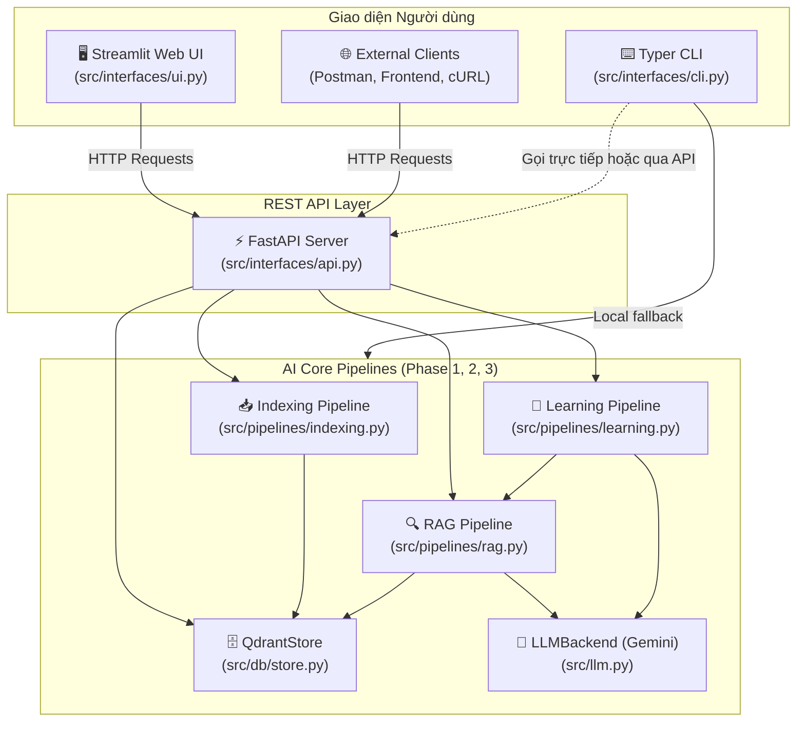

# 🚀 Phase 4 — Interfaces (API, CLI, UI): Kế hoạch Triển khai Chi tiết

> **Mục tiêu:** Xây dựng toàn bộ các giao diện người dùng để tương tác toàn diện với hệ thống RAG & Learning Features qua cả 3 kênh: **FastAPI REST API**, **Typer CLI**, và **Streamlit Web UI**.

---

## 1. Tổng quan Kiến trúc Giao diện



---

## 2. Danh sách Files cần Tạo & Sửa

| # | File | Hành động | Mục đích |
|---|------|:---------:|---------|
| 1 | `src/interfaces/__init__.py` | **Tạo mới** | Đánh dấu package interfaces |
| 2 | [`src/interfaces/api.py`](file:///d:/RAG_Learning_System/src/interfaces/api.py) | **Tạo mới** | FastAPI app: 7 endpoints chính + health check + CORS + upload handling |
| 3 | [`src/interfaces/cli.py`](file:///d:/RAG_Learning_System/src/interfaces/cli.py) | **Tạo mới** | Typer CLI: 7 lệnh tương tác terminal định dạng màu sắc (`rich`/ANSI) |
| 4 | [`src/interfaces/styles.py`](file:///d:/RAG_Learning_System/src/interfaces/styles.py) | **Tạo mới** | Custom CSS hiện đại (glassmorphism nhẹ, thẻ citation có màu, quiz interactive, flashcard flip) |
| 5 | [`src/interfaces/ui.py`](file:///d:/RAG_Learning_System/src/interfaces/ui.py) | **Tạo mới** | Streamlit Web App: 4 Tabs (Q&A, Summary, Quiz MCQ, Flashcards) kết nối qua API |
| 6 | [`test_interfaces.py`](file:///d:/RAG_Learning_System/test_interfaces.py) | **Tạo mới** | Test suite kiểm tra tự động toàn bộ API endpoints và CLI commands |
| 7 | [`docs/phase4_interfaces_plan.md`](file:///d:/RAG_Learning_System/docs/phase4_interfaces_plan.md) | **Tạo mới** | Bản kế hoạch lưu trữ trong thư mục tài liệu dự án |

---

## 3. Đặc tả Kỹ thuật Chi tiết từng Kênh

### 3.1. Kênh 1: FastAPI REST API (`src/interfaces/api.py`)

FastAPI server cung cấp toàn bộ năng lực của hệ thống dưới dạng chuẩn RESTful API, tài liệu hóa tự động qua Swagger UI (`/docs`).

#### A. Request & Response Schemas:
```python
class AskRequest(BaseModel):
    question: str
    document_id: Optional[str] = None

class SummarizeRequest(BaseModel):
    document_id: str

class QuizRequest(BaseModel):
    document_id: str
    topic: Optional[str] = None
    n_questions: int = Field(default=8, ge=1, le=20)

class FlashcardsRequest(BaseModel):
    document_id: str
    topic: Optional[str] = None
    n_cards: int = Field(default=15, ge=1, le=30)

class UploadResponse(BaseModel):
    document_id: str
    filename: str
    total_chunks: int
    message: str

class DeleteResponse(BaseModel):
    document_id: str
    message: str
```

#### B. Bảng Endpoints:

| Endpoint | Method | Input | Output | Chức năng |
|---|:---:|---|---|---|
| `/health` | `GET` | Không | `dict` | Kiểm tra trạng thái hệ thống (Qdrant connected, LLM configured) |
| `/upload` | `POST` | `file: UploadFile`, `force_reindex: bool = False` | `UploadResponse` | Nhận PDF, lưu tạm, gọi `index_pdf()`, trả về `document_id` và số chunk |
| `/documents` | `GET` | Không | `List[dict]` | Danh sách tài liệu đã index trong Qdrant (`list_documents()`) |
| `/documents/{doc_id}` | `DELETE` | Path: `doc_id` | `DeleteResponse` | Xóa tài liệu khỏi Qdrant (`delete_document()`) |
| `/ask` | `POST` | `AskRequest` | `RagAnswer` | Trả lời câu hỏi có trích dẫn inline `[S1]`, `[S2]` và `Citation` list |
| `/summarize` | `POST` | `SummarizeRequest` | `Summary` | Tóm tắt tài liệu theo cơ chế Single hoặc Map-Reduce |
| `/quiz` | `POST` | `QuizRequest` | `QuizSet` | Tạo bộ câu hỏi trắc nghiệm MCQ (A, B, C, D) có giải thích |
| `/flashcards` | `POST` | `FlashcardsRequest` | `FlashcardSet` | Tạo bộ thẻ ghi nhớ (front / back) |

---

### 3.2. Kênh 2: Typer CLI (`src/interfaces/cli.py`)

Ứng dụng CLI mạnh mẽ, trực quan, hỗ trợ tương tác nhanh từ dòng lệnh, tích hợp màu sắc và bảng biểu:

```bash
python -m src.interfaces.cli --help
```

#### Bảng lệnh CLI:

| Lệnh | Cú pháp | Mô tả |
|---|---|---|
| **`index`** | `python -m src.interfaces.cli index <pdf_path> [--force]` | Nạp tệp PDF vào hệ thống vector |
| **`ask`** | `python -m src.interfaces.cli ask "<câu hỏi>" [--doc-id <id>]` | Đặt câu hỏi, in câu trả lời và bảng citations có màu sắc |
| **`summarize`**| `python -m src.interfaces.cli summarize <doc_id>` | In bản tóm tắt tài liệu kèm phương pháp và số chunk |
| **`quiz`** | `python -m src.interfaces.cli quiz <doc_id> [--topic <t>] [--n <8>] [--interactive]` | In danh sách câu hỏi trắc nghiệm; flag `--interactive` cho phép người dùng tự làm bài và chấm điểm ngay trên terminal |
| **`flashcards`**| `python -m src.interfaces.cli flashcards <doc_id> [--topic <t>] [--n <15>]` | In toàn bộ thẻ flashcards ra màn hình dạng bảng hoặc thẻ |
| **`list-docs`**| `python -m src.interfaces.cli list-docs` | Hiển thị bảng tổng hợp tài liệu đã nạp (ID, tên file, số chunk, số trang) |
| **`delete-doc`**| `python -m src.interfaces.cli delete-doc <doc_id> [--yes]` | Xóa tài liệu khỏi hệ thống kèm bước xác nhận an toàn |

---

### 3.3. Kênh 3: Streamlit Web UI (`src/interfaces/ui.py` & `styles.py`)

Ứng dụng web đồ họa đầy đủ, thiết kế hiện đại, giao diện trực quan mang lại trải nghiệm học tập giống NotebookLM:

#### A. Kiến trúc Giao diện Streamlit:
1. **Sidebar Điều khiển:**
   - **Cấu hình API URL**: Nhập địa chỉ FastAPI server (mặc định: `http://localhost:8000`), có đèn báo trạng thái (🟢 Kết nối thành công / 🔴 Chưa kết nối).
   - **Upload Tài liệu PDF**: Hỗ trợ kéo thả PDF, nút bấm "Nạp tài liệu" (Upload & Indexing) với thanh spinner tiến trình.
   - **Quản lý Tài liệu**: Hộp chọn (Selectbox) để chọn tài liệu làm ngữ cảnh làm việc (hoặc chọn *"Tất cả tài liệu"* cho Q&A); nút bấm "Xóa tài liệu" có dialog xác nhận.
   - **Thống kê nhanh**: Hiển thị tổng số tài liệu, tổng số chunks, kích thước bộ nhớ vector.

2. **Khu vực Nội dung Chính (4 Tabs chuyên biệt):**
   - **Tab 1: 💬 Hỏi đáp (Q&A):**
     - Hộp thoại hỏi đáp thông minh.
     - Hiển thị câu trả lời markdown với các huy hiệu trích dẫn inline `[S1]`, `[S2]` được tô màu nổi bật.
     - Khung Accordion trích dẫn nguồn: Hiển thị chi tiết tên file, số trang, điểm relevance score và nội dung chunk trích dẫn thực tế.
   - **Tab 2: 📝 Tóm tắt (Summary):**
     - Nút bấm "Tạo bản tóm tắt".
     - Huy hiệu thể hiện chiến lược tóm tắt: `Single Pass` (tài liệu ngắn) hoặc `Map-Reduce` (tài liệu nhiều trang).
     - Văn bản tóm tắt được trình bày khoa học với các đề mục, gạch đầu dòng rõ ràng.
   - **Tab 3: 🎯 Trắc nghiệm (Interactive Quiz):**
     - Bộ lọc: Chọn chủ đề chuyên sâu (Topic) và số lượng câu hỏi (3 đến 15 câu).
     - Nút "Tạo bộ câu hỏi".
     - **Giao diện làm bài thi trực tiếp:** Từng câu hỏi hiển thị dạng Radio options (A, B, C, D).
     - Nút "Nộp bài & Chấm điểm": Tính điểm số (Ví dụ: `8/10 câu đúng - 80%`), tự động đổi màu đáp án (Xanh = Đúng, Đỏ = Chọn sai), và mở khung giải thích chi tiết tại sao đáp án đó đúng.
   - **Tab 4: 🗂️ Thẻ ghi nhớ (Flashcards):**
     - Tùy chọn chủ đề và số thẻ (5 đến 20 thẻ).
     - Nút "Tạo Flashcards".
     - **Thẻ ghi nhớ lật mặt (Flip Card):** Hiển thị thẻ card to rõ, nút bấm "Lật mặt sau" để xem đáp án / giải thích.
     - Bộ điều hướng: Nút "Thẻ trước" (Prev), "Thẻ tiếp theo" (Next), chỉ báo số thứ tự `Thẻ 3 / 10`.
     - Nút "Xáo trộn ngẫu nhiên" (Shuffle) và chế độ xem toàn bộ danh sách (List view).

3. **Custom CSS (`styles.py`):**
   - Theme hiện đại, font chữ rõ ràng, độ tương phản cao.
   - Hiệu ứng đổ bóng card nhẹ (subtle box-shadow), viền bo tròn (border-radius: 12px).
   - Màu sắc phân biệt rõ ràng: Citation badge (màu tím/xanh dương), Quiz correct (xanh lá cây), Quiz wrong (đỏ nhạt).

---

## 4. Kế hoạch Kiểm thử Tự động (`test_interfaces.py`)

Bộ kiểm thử được xây dựng bằng `fastapi.testclient.TestClient` và `typer.testing.CliRunner`:

| # | Tên Test Case | Phạm vi kiểm tra | Phương pháp |
|---|---|---|---|
| 1 | `test_api_health` | Kiểm tra endpoint `/health` | `client.get("/health")` |
| 2 | `test_api_documents` | Kiểm tra danh sách documents `/documents` | `client.get("/documents")` |
| 3 | `test_api_ask` | Kiểm tra hỏi đáp RAG `/ask` | `client.post("/ask", json={...})` |
| 4 | `test_api_summarize` | Kiểm tra tóm tắt `/summarize` | `client.post("/summarize", json={...})` |
| 5 | `test_api_quiz` | Kiểm tra tạo quiz `/quiz` | `client.post("/quiz", json={...})` |
| 6 | `test_api_flashcards` | Kiểm tra tạo flashcards `/flashcards` | `client.post("/flashcards", json={...})` |
| 7 | `test_cli_commands` | Kiểm tra các lệnh CLI `list-docs`, `ask`, v.v. | `CliRunner.invoke(app, [...])` |

---

## 5. Kế hoạch Triển khai từng Bước & Ước tính Thời gian

```mermaid
gantt
    title Kế hoạch triển khai Phase 4
    dateFormat  X
    axisFormat %s

    section Bước 1
    Tạo src/interfaces/__init__.py & api.py (FastAPI)     :active, b1, 0, 5
    section Bước 2
    Tạo src/interfaces/cli.py (Typer CLI)                 :b2, after b1, 4
    section Bước 3
    Tạo src/interfaces/styles.py (Custom CSS & HTML)      :b3, after b2, 3
    section Bước 4
    Tạo src/interfaces/ui.py (Streamlit Web UI 4 Tabs)    :b4, after b3, 6
    section Bước 5
    Tạo test_interfaces.py & Chạy Test Suite              :b5, after b4, 4
    section Bước 6
    Khởi động server & Kiểm thử thực tế qua Browser/CLI   :b6, after b5, 3
```



- **Tổng thời gian ước tính:** ~25 phút.
- **Yêu cầu môi trường:** Đã cài đặt đủ `fastapi`, `uvicorn`, `streamlit`, `typer`, `httpx` (đã kiểm tra và sẵn sàng 100%).

---

## 6. Hướng dẫn Khởi chạy sau khi hoàn thành

### 1. Khởi chạy FastAPI Server:
```bash
uvicorn src.interfaces.api:app --reload --port 8000
# Truy cập Swagger API Docs tại: http://localhost:8000/docs
```

### 2. Sử dụng Typer CLI:
```bash
python -m src.interfaces.cli list-docs
python -m src.interfaces.cli ask "Finora là gì?"
python -m src.interfaces.cli quiz <document_id> --interactive
```

### 3. Khởi chạy Streamlit Web App:
```bash
streamlit run src/interfaces/ui.py
# Ứng dụng tự động mở tại: http://localhost:8501
```
