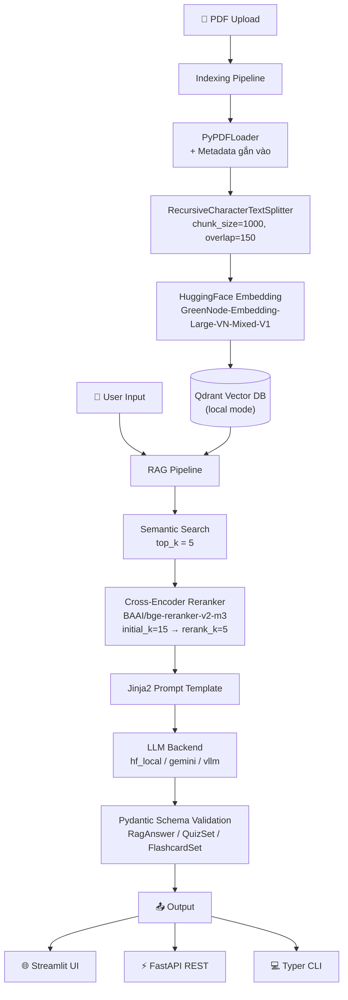

# 📋 Project Plan: RAG for Learning System — Building a Simple NotebookLM

> **Trạng thái:** Giai đoạn Lập kế hoạch | **Ngày:** 2026-10-03  
> **Mục tiêu:** Xây dựng hoàn chỉnh hệ thống RAG học tập cá nhân hóa từ tài liệu PDF

---

## 1. Tổng quan Kiến trúc



---

## 2. Cấu trúc Thư mục Dự án

```
RAG_Learning_System/
├── src/
│   ├── config.py              # Pydantic BaseSettings — toàn bộ cấu hình hệ thống
│   ├── schemas.py             # Data models: ChunkMetadata, RagAnswer, QuizSet, FlashcardSet...
│   ├── indexing.py            # Load PDF → chunk → chuẩn bị embed (SHA1 document_id)
│   ├── store.py               # Kết nối Qdrant + Embedding model
│   ├── rag.py                 # RAG core: retrieve → rerank → prompt → LLM
│   ├── learning.py            # Summarize (Map-Reduce), Quiz, Flashcard generation
│   ├── llm.py                 # LLM backend abstraction (hf_local / gemini / vllm)
│   ├── prompts/               # Jinja2 templates (.j2)
│   │   ├── qa.j2
│   │   ├── summary_single.j2
│   │   ├── summary_map.j2
│   │   ├── summary_reduce.j2
│   │   ├── quiz.j2
│   │   └── flashcard.j2
│   └── interfaces/
│       ├── api.py             # FastAPI app
│       ├── cli.py             # Typer CLI
│       ├── ui.py              # Streamlit UI
│       └── styles.py          # CSS/styling cho Streamlit
├── src/evaluation/
│   ├── dataset.py             # Tạo/quản lý benchmark dataset (Q&A + ground truth)
│   ├── run_baseline.py        # Chạy evaluation baseline
│   ├── run_chunking.py        # So sánh Recursive vs Semantic chunking
│   ├── run_reranking.py       # Đánh giá hiệu quả Cross-Encoder reranking
│   └── report.py              # Tổng hợp & in kết quả (Ragas metrics)
├── data/
│   └── pdfs/                  # Thư mục chứa tài liệu PDF của người dùng
├── qdrant_storage/            # Qdrant local storage
├── .env                       # Biến môi trường (API keys, model paths...)
├── requirements.txt
└── README.md
```

---

## 3. Kế hoạch Triển khai — Phân chia theo Phase

### Phase 0 — Cài đặt môi trường & Scaffolding
**Mục tiêu:** Có đủ dependencies, cấu trúc thư mục, và config hệ thống.

| Task | Chi tiết kỹ thuật | Ưu tiên |
|------|-------------------|---------|
| 0.1 Tạo `requirements.txt` | langchain, langchain-community, qdrant-client, sentence-transformers, transformers, pypdf, pydantic-settings, fastapi, uvicorn, typer, streamlit, httpx, jinja2, ragas, pydantic | 🔴 Critical |
| 0.2 Tạo `.env` template | GEMINI_API_KEY, LLM_BACKEND, EMBEDDING_MODEL, QDRANT_PATH, v.v. | 🔴 Critical |
| 0.3 Viết `src/config.py` | Pydantic `BaseSettings` load từ `.env`, có default values rõ ràng | 🔴 Critical |
| 0.4 Viết `src/schemas.py` | Toàn bộ Pydantic models: `ChunkMetadata`, `RetrievedChunk`, `Citation`, `RagAnswer`, `Summary`, `QuizItem`, `QuizSet`, `Flashcard`, `FlashcardSet` | 🔴 Critical |

---

### Phase 1 — Indexing Pipeline
**Mục tiêu:** Nạp được tài liệu PDF → lưu vào Qdrant thành công.

| Task | Chi tiết kỹ thuật | Ưu tiên |
|------|-------------------|---------|
| 1.1 Viết `src/indexing.py` | `PyPDFLoader` load PDF, gắn metadata (filename, page, source), hash SHA1 làm `document_id`, `RecursiveCharacterTextSplitter(chunk_size=1000, chunk_overlap=150)` | 🔴 Critical |
| 1.2 Viết `src/store.py` | Khởi tạo Qdrant client (local path), load HuggingFace embedding model (`GreenNode/GreenNode-Embedding-Large-VN-Mixed-V1`), tạo collection nếu chưa có, tạo payload index cho `document_id`, `filename`, `page` | 🔴 Critical |
| 1.3 Kiểm thử indexing | Nạp 1 PDF thử, kiểm tra vector trong Qdrant qua scroll API | 🟡 High |

---

### Phase 2 — RAG Core Pipeline
**Mục tiêu:** Trả lời câu hỏi dựa trên tài liệu đã nạp, có trích dẫn nguồn.

| Task | Chi tiết kỹ thuật | Ưu tiên |
|------|-------------------|---------|
| 2.1 Viết `src/llm.py` | Abstract class `LLMBackend` + 3 implementations: `HFLocalBackend`, `GeminiBackend`, `vLLMBackend`. Factory function `get_llm(backend: str)` | 🔴 Critical |
| 2.2 Tạo Jinja2 templates | Tạo thư mục `src/prompts/`, viết `qa.j2` với placeholder cho `context` (markers S1, S2...) và `question` | 🔴 Critical |
| 2.3 Viết `src/rag.py` (retrieve) | Hàm `retrieve(query, top_k=5)`: embed query → semantic search Qdrant → trả về `List[RetrievedChunk]` | 🔴 Critical |
| 2.4 Viết `src/rag.py` (rerank) | Hàm `rerank(chunks, query, rerank_k=5)`: load `CrossEncoder("BAAI/bge-reranker-v2-m3")`, score từng chunk, sort và lấy top rerank_k | 🟡 High |
| 2.5 Viết `src/rag.py` (answer) | Hàm `answer(query)`: retrieve(initial_k=15) → rerank(rerank_k=5) → render Jinja2 prompt → gọi LLM → parse ra `RagAnswer` (text + citations) | 🔴 Critical |
| 2.6 Viết `fetch_all_chunks` | Dùng Qdrant Scroll API để lấy toàn bộ chunks của 1 document, phục vụ cho Summarization | 🟡 High |

---

### Phase 3 — Learning Features
**Mục tiêu:** Tóm tắt, tạo Quiz và Flashcard từ tài liệu.

| Task | Chi tiết kỹ thuật | Ưu tiên |
|------|-------------------|---------|
| 3.1 Tạo templates cho learning | Viết `summary_single.j2`, `summary_map.j2`, `summary_reduce.j2`, `quiz.j2`, `flashcard.j2` | 🔴 Critical |
| 3.2 Viết `summarize()` trong `learning.py` | Nếu document ngắn: dùng `SUMMARY_SINGLE_TEMPLATE`. Nếu dài: **Map-Reduce** — chia batch (batch_size=10 chunks), map từng batch → tóm tắt riêng, sau đó reduce → tóm tắt tổng | 🔴 Critical |
| 3.3 Viết `generate_quiz()` | Retrieve relevant chunks → render `quiz.j2` (yêu cầu 8 câu MCQ) → gọi LLM → `_parse_json()` làm sạch markdown fences → `_validate_items()` loại trùng/invalid → parse `QuizSet` | 🔴 Critical |
| 3.4 Viết `generate_flashcards()` | Tương tự quiz nhưng dùng `flashcard.j2` (15 thẻ), output `FlashcardSet` với `front`/`back` | 🔴 Critical |
| 3.5 Viết helper `_parse_json()` | Strip ```json ... ``` markdown fences từ LLM response, xử lý edge cases | 🟡 High |
| 3.6 Viết helper `_validate_items()` | Loại bỏ items thiếu field bắt buộc hoặc bị duplicate | 🟡 High |

---

### Phase 4 — Interfaces (API, CLI, UI)
**Mục tiêu:** Người dùng có thể tương tác qua cả 3 kênh.

#### 4A. FastAPI (`src/interfaces/api.py`)

| Endpoint | Method | Chi tiết |
|----------|--------|---------|
| `/upload` | `POST` | Nhận file PDF, gọi indexing pipeline, trả về `document_id` |
| `/documents` | `GET` | Liệt kê các tài liệu đã nạp |
| `/documents/{doc_id}` | `DELETE` | Xóa tài liệu khỏi Qdrant |
| `/ask` | `POST` | Body: `{question, document_id?}`, trả về `RagAnswer` |
| `/summarize` | `POST` | Body: `{document_id}`, trả về `Summary` |
| `/quiz` | `POST` | Body: `{document_id, topic?, n_questions=8}`, trả về `QuizSet` |
| `/flashcards` | `POST` | Body: `{document_id, topic?, n_cards=15}`, trả về `FlashcardSet` |

#### 4B. Typer CLI (`src/interfaces/cli.py`)

| Command | Chi tiết |
|---------|---------|
| `index <pdf_path>` | Nạp tài liệu PDF vào hệ thống |
| `ask "<question>"` | Hỏi đáp, in kết quả + citations |
| `summarize <doc_id>` | In tóm tắt tài liệu |
| `quiz <doc_id>` | In quiz MCQ ra terminal |
| `flashcards <doc_id>` | In flashcards ra terminal |
| `list-docs` | Liệt kê tài liệu đã nạp |

#### 4C. Streamlit UI (`src/interfaces/ui.py`)

| Thành phần | Chi tiết |
|-----------|---------|
| Sidebar | Upload PDF, danh sách tài liệu đã nạp, selector chọn document |
| Tab 1: Q&A | Input câu hỏi, hiển thị câu trả lời + citations có màu đánh dấu |
| Tab 2: Summary | Nút "Tóm tắt", hiển thị kết quả có citations |
| Tab 3: Quiz | Nút "Tạo Quiz", hiển thị MCQ interative (chọn đáp án, chấm điểm) |
| Tab 4: Flashcards | Flip card animation (front/back), nút next/prev |
| `styles.py` | Custom CSS cho Streamlit |

> **Lưu ý:** Streamlit UI gọi API của FastAPI thông qua `httpx` (async), không gọi trực tiếp hàm Python.

---

### Phase 5 — Evaluation & Thực nghiệm
**Mục tiêu:** Đo lường chất lượng hệ thống và tối ưu hóa.

| Task | Chi tiết kỹ thuật | Ưu tiên |
|------|-------------------|---------|
| 5.1 Tạo benchmark dataset | File JSON chứa list `{question, ground_truth, document_id}` | 🟡 High |
| 5.2 Viết `run_baseline.py` | Chạy RAG pipeline cơ bản, thu thập `{question, answer, contexts, ground_truth}` | 🟡 High |
| 5.3 Viết `run_chunking.py` | So sánh 2 chiến lược: Recursive (size=1000,overlap=150) vs Semantic Chunking (ngưỡng: percentile / std_dev / interquartile) | 🟡 High |
| 5.4 Viết `run_reranking.py` | Retrieve 15 chunks thô, rerank giữ 5, so sánh metrics trước/sau rerank | 🟡 High |
| 5.5 Viết `report.py` | Dùng **Ragas** tính 4 metrics: `context_recall`, `context_precision`, `faithfulness`, `answer_relevancy`. In bảng so sánh | 🟡 High |

#### 📊 Kết quả kỳ vọng (theo tài liệu):
| Cấu hình | Context Precision | Context Recall | Faithfulness | Answer Relevancy |
|----------|:-----------------:|:--------------:|:------------:|:----------------:|
| Baseline | thấp | thấp | trung bình | trung bình |
| + Recursive (1000/150) | tốt | tốt | tốt | tốt |
| + Semantic Chunking | biến thiên | biến thiên | cao nhất | tốt |
| **+ Recursive + Reranking** | **> 0.92** | **> 0.92** | **cao** | **cao** |

---

## 4. Chi tiết Kỹ thuật Quan trọng

### 4.1 Config System (`src/config.py`)
```
Settings (Pydantic BaseSettings):
├── LLM_BACKEND: str = "gemini"          # hf_local | gemini | vllm
├── GEMINI_API_KEY: str = ""
├── HF_MODEL_ID: str = "..."             # cho hf_local
├── VLLM_BASE_URL: str = "..."           # cho vllm
├── EMBEDDING_MODEL: str = "GreenNode/GreenNode-Embedding-Large-VN-Mixed-V1"
├── QDRANT_PATH: str = "./qdrant_storage"
├── COLLECTION_NAME: str = "documents"
├── CHUNK_SIZE: int = 1000
├── CHUNK_OVERLAP: int = 150
├── TOP_K: int = 5
├── INITIAL_K: int = 15                  # cho reranking
├── RERANK_K: int = 5
├── SUMMARIZE_BATCH_SIZE: int = 10
├── N_QUIZ_QUESTIONS: int = 8
└── N_FLASHCARDS: int = 15
```

### 4.2 Schema Hierarchy (`src/schemas.py`)
```
ChunkMetadata
└── document_id: str       # SHA1 hash(filename + filesize)
    filename: str
    source: str            # đường dẫn file gốc
    page: int
    chunk_id: str
    section: Optional[str]

RetrievedChunk
└── content: str
    metadata: ChunkMetadata
    score: float

Citation
└── marker: str            # "S1", "S2", ...
    chunk: RetrievedChunk

RagAnswer
└── answer: str            # câu trả lời, có inline markers [S1][S2]
    citations: List[Citation]
    chunks: List[RetrievedChunk]

Summary (tương tự RagAnswer)
QuizItem
└── question: str
    options: List[str]     # A, B, C, D
    answer: str            # "A" | "B" | "C" | "D"
    explanation: str

QuizSet
└── items: List[QuizItem]
    citations: List[Citation]

Flashcard
└── front: str             # câu hỏi / khái niệm
    back: str              # đáp án / giải thích

FlashcardSet
└── cards: List[Flashcard]
    citations: List[Citation]
```

### 4.3 Reranking Flow
```
User Query
    │
    ▼
Qdrant Semantic Search (initial_k = 15 chunks)
    │
    ▼
CrossEncoder("BAAI/bge-reranker-v2-m3")
  - Input: [(query, chunk_content) for each chunk]
  - Output: relevance_score (float) cho từng cặp
    │
    ▼
Sort by score DESC → lấy top rerank_k = 5
    │
    ▼
Jinja2 Prompt Rendering → LLM
```

### 4.4 Map-Reduce Summarization
```
fetch_all_chunks(document_id)  →  [chunk_1, chunk_2, ..., chunk_N]
    │
    ├─ Nếu N ≤ SUMMARIZE_BATCH_SIZE (10):
    │       summary_single.j2 → LLM → Summary
    │
    └─ Nếu N > 10:
            Chia batch (mỗi batch 10 chunks)
                │
                ▼
            Map: summary_map.j2 → LLM → intermediate summaries
                │
                ▼
            Reduce: summary_reduce.j2 (tổng hợp tất cả intermediate) → LLM → Final Summary
```

---

## 5. Thứ tự Ưu tiên Triển khai

```
Phase 0 (Setup)           ██████████ 100% priority
    ↓
Phase 1 (Indexing)        ██████████ Core foundation
    ↓
Phase 2 (RAG Core)        ██████████ Core feature
    ↓
Phase 3 (Learning)        ████████░░ Main differentiator
    ↓
Phase 4A (FastAPI)        ███████░░░ Backend interface
    ↓
Phase 4B (CLI)            ██████░░░░ Dev/test interface
    ↓
Phase 4C (Streamlit)      █████░░░░░ End-user interface
    ↓
Phase 5 (Evaluation)      ████░░░░░░ Quality assurance
```

---

## 6. Các Rủi ro & Giải pháp

| Rủi ro | Tác động | Giải pháp |
|--------|----------|-----------|
| LLM trả về JSON không hợp lệ | Quiz/Flashcard parse lỗi | Implement `_parse_json()` + `_validate_items()` + retry logic |
| PDF tiếng Việt bị lỗi encoding | Chunk rỗng hoặc garbage text | Test kỹ với PyPDFLoader, fallback sang pdfplumber |
| Embedding model quá nặng (local) | Chậm khi nạp tài liệu | Cache model instance ở `store.py`, lazy loading |
| Qdrant local bị corrupt | Mất toàn bộ index | Backup `qdrant_storage/` định kỳ, tạo script re-index |
| Cross-Encoder quá chậm | Latency cao khi trả lời | Batch scoring, cache kết quả nếu query trùng lặp |
| Context window LLM vượt giới hạn | Lỗi khi summarize tài liệu dài | Map-Reduce strategy, limit batch_size |

---

## 7. Câu hỏi Cần Xác nhận Trước Khi Code

> [!IMPORTANT]
> Cần xác nhận các điểm sau trước khi bắt đầu Phase 0:

1. **LLM Backend nào được dùng chính?** Gemini API (cần key) hay HuggingFace local?
2. **Môi trường Python?** Cần tạo `venv` hay đã có sẵn môi trường?
3. **GPU có sẵn không?** Ảnh hưởng đến việc chạy embedding model và Cross-Encoder.
4. **Ngôn ngữ tài liệu PDF?** Tiếng Việt, tiếng Anh hay cả hai? (ảnh hưởng chọn embedding model)
5. **Streamlit UI có cần authen (login) không?** Hay public access?
6. **Có cần Docker/containerization không?**
